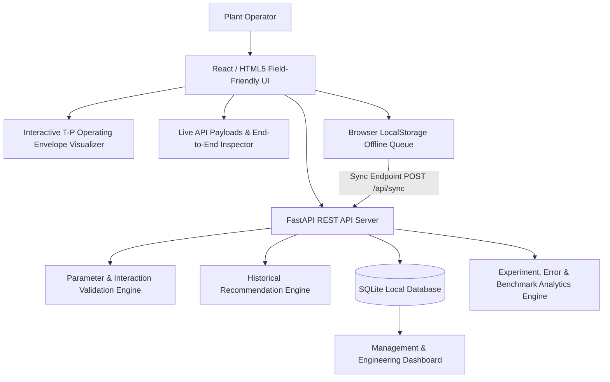

# System Architecture Specification

## Overview

The **Process Plant Digital Setup Guide with Parameter Validation and First-Piece Learning** is a lightweight, field-friendly application designed for high reliability in low-bandwidth or offline plant environments.

## System Components

1. **Field-Friendly UI**:
   - Touch-optimized checklist step navigation with gating.
   - Live 2D canvas/SVG interaction envelope plot.
   - Live API Payload & End-to-End Inspector showing working request/response JSON payloads.
   - Online/Offline mode toggle & sync status indicator.

2. **Parameter Validation Engine**:
   - Evaluates individual limits $T_{min} \le T \le T_{max}$ and $P_{min} \le P \le P_{max}$.
   - Computes non-linear multivariate polynomial boundary score $S_{int} = x^2 + y^2 + 0.6xy$.
   - Categorizes status as `VALID`, `WARNING`, or `BLOCKED` with human-readable rationale.

3. **Historical Recommendation Engine**:
   - Filters historical setups where `pass_fail == 1` and `validation_status IN ('VALID', 'WARNING')`.
   - Derives recommended starting $T$ and $P$.
   - Enforces strict safety boundary clamping.

4. **Offline Synchronization Engine**:
   - Caches completed setup and inspection records in browser `localStorage` when offline.
   - Preserves offline setup IDs (`SET-OFFLINE-...`) so first-piece inspection records link correctly.
   - Retains local records if sync fails, retries idempotently, and prevents duplicate server insertions (`INSERT OR IGNORE`).

---

## Mathematical & Algorithmic Formulation of the Non-Linear Operating Envelope

### 1. Parameter Normalization
Given actual temperature $T$ (°C) and actual pressure $P$ (bar) for product variant $V$, parameters are normalized into continuous dimensionless space $[-1.0, 1.0]$:

$$x = \frac{T - T_{target}}{\Delta T_{max}}, \quad y = \frac{P - P_{target}}{\Delta P_{max}}$$

where:
- $\Delta T_{max} = T_{max} - T_{target}$ (e.g., $185.0 - 180.0 = 5.0^\circ\text{C}$ for Variant A)
- $\Delta P_{max} = P_{max} - P_{target}$ (e.g., $5.3 - 5.0 = 0.3\text{ bar}$ for Variant A)

### 2. Multivariate Polynomial Boundary Function $\Phi(T, P)$
The non-linear interaction boundary function $\Phi(T, P)$ is defined as a second-order multivariate polynomial quadratic form with a positive thermo-hydraulic coupling coefficient $\gamma = 0.6$:

$$\Phi(T, P) = x^2 + y^2 + \gamma \cdot x \cdot y$$

The term $\gamma \cdot x \cdot y$ models the positive non-linear interaction coupling where simultaneous high temperature and high pressure induce combined thermal expansion and hydraulic compression stress exceeding individual parameter limits.

### 3. Geometric Convex Hull & Elliptical Boundary
Geometrically, the boundary equation $\Phi(T, P) = 1.00$ defines a rotated ellipse in normalized $(x, y)$ space centered at $(0,0)$:

$$\begin{bmatrix} x & y \end{bmatrix} \begin{bmatrix} 1 & \frac{\gamma}{2} \\ \frac{\gamma}{2} & 1 \end{bmatrix} \begin{bmatrix} x \\ y \end{bmatrix} \le 1.00$$

Since the symmetric matrix $M = \begin{bmatrix} 1 & 0.3 \\ 0.3 & 1 \end{bmatrix}$ is positive-definite (eigenvalues $\lambda_1 = 1.3, \lambda_2 = 0.7 > 0$), the operating envelope forms a strictly convex operating region rotated $-45^\circ$ in the normalized coordinate system.

### 4. Categorical Classification Logic
$$\text{Status}(T, P) = \begin{cases} 
\text{BLOCKED}, & \text{if } T < T_{min} \lor T > T_{max} \\
\text{BLOCKED}, & \text{if } P < P_{min} \lor P > P_{max} \\
\text{BLOCKED (Interaction Failure)}, & \text{if } \Phi(T, P) > 1.00 \\
\text{WARNING (Near Boundary)}, & \text{if } 0.75 < \Phi(T, P) \le 1.00 \\
\text{VALID (Safe Operating Window)}, & \text{if } \Phi(T, P) \le 0.75
\end{cases}$$

---

> **Synthetic Prototype Data Disclaimer**  
> Prototype only. All parameter limits, operating envelopes, recommendations, and experimental results are synthetic demonstration assumptions and must not be used as real plant operating instructions.
