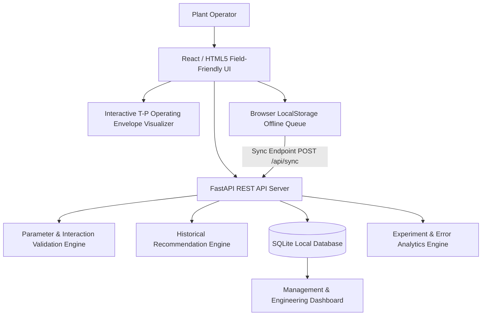

# System Architecture Specification

## Overview

The **Process Plant Digital Setup Guide with Parameter Validation and First-Piece Learning** is a lightweight, field-friendly application designed for high reliability in low-bandwidth or offline plant environments.

## System Components

1. **Field-Friendly UI**:
   - Touch-optimized checklist step navigation with gating.
   - Live canvas/SVG interaction envelope plot.
   - Online/Offline mode toggle & sync status indicator.

2. **Parameter Validation Engine**:
   - Evaluates individual limits $T_{min} \le T \le T_{max}$ and $P_{min} \le P \le P_{max}$.
   - Computes quadratic interaction score $S_{int} = x^2 + y^2 + 0.6xy$ where $x, y$ are normalized deviations.
   - Categorizes status as `VALID`, `WARNING`, or `BLOCKED` with human-readable rationale.

3. **Historical Recommendation Engine**:
   - Filters historical setups where `pass_fail == 1` and `validation_status IN ('VALID', 'WARNING')`.
   - Derives recommended starting $T$ and $P$.
   - Enforces strict safety boundary clamping.

4. **Offline Synchronization Engine**:
   - Caches completed setup and inspection records in browser `localStorage` when offline.
   - Batches records to `/api/sync` when connectivity is restored.

---

> **Synthetic Prototype Data Disclaimer**
> Prototype only. All parameter limits, operating envelopes, recommendations, and experimental results are synthetic demonstration assumptions and must not be used as real plant operating instructions.
